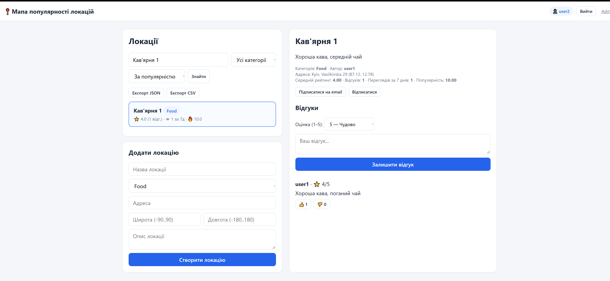
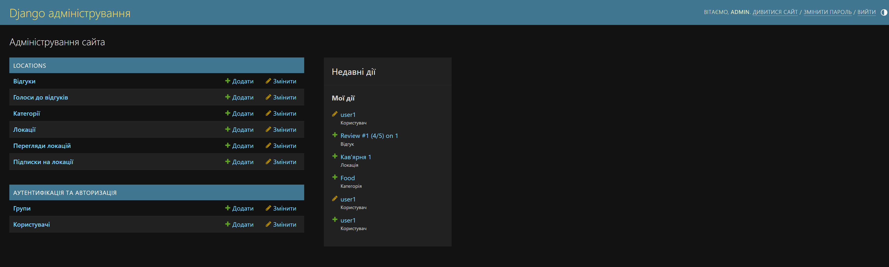
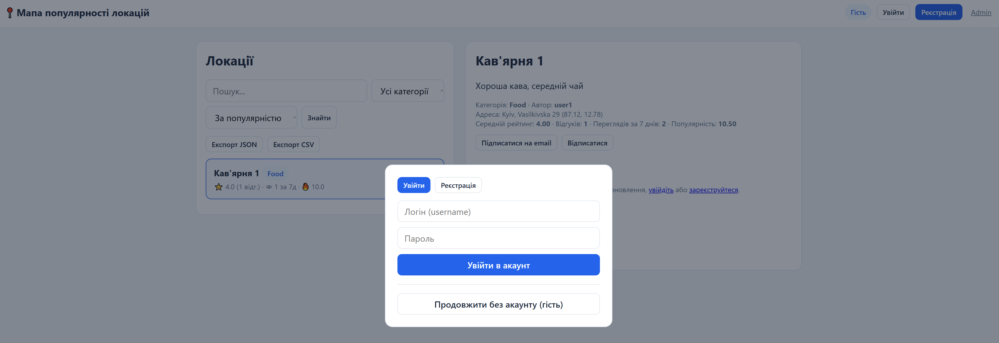
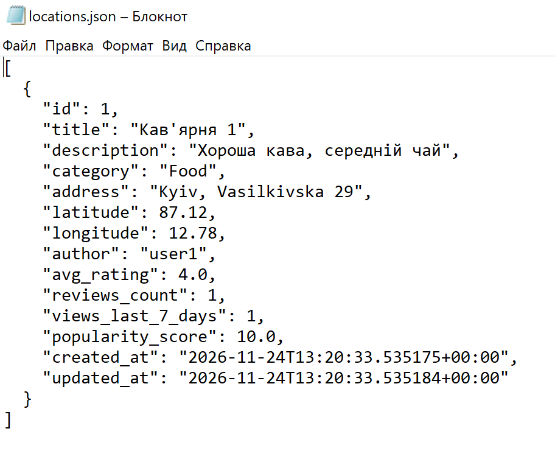
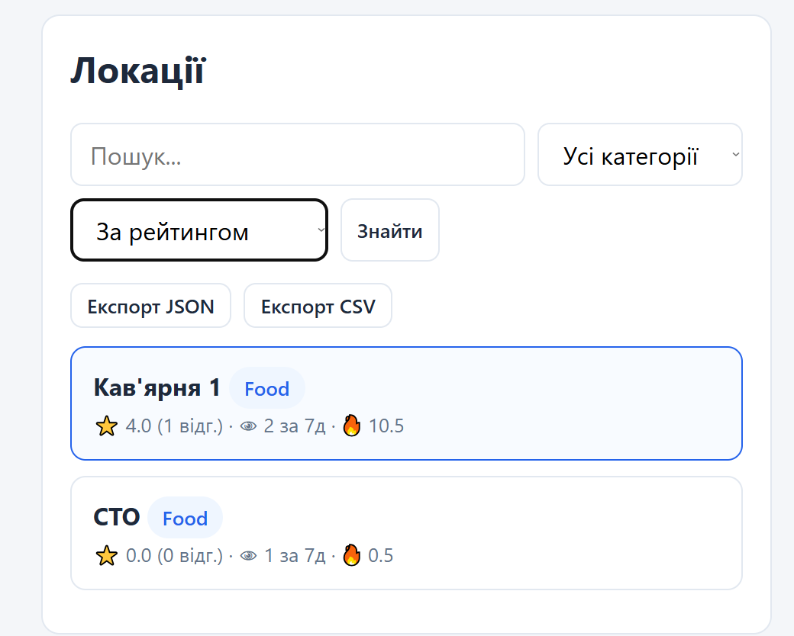

# Мапа популярності локацій (Django REST Framework)

REST API сервіс для додавання цікавих локацій, оцінювання, відгуків, перегляду популярних місць, експорту даних у JSON/CSV та email-сповіщень.







## Технологічний стек
- **Python 3.12**, **Django 5.1**, **Django REST Framework**
- **PostgreSQL 16** (у Docker-контейнері з автоматичним створенням БД та користувача)
- **Redis 7** (у Docker-контейнері — лічильник переглядів 1 раз/год та кешування списку локацій)
- **Session + Cookies** аутентифікація Django (без JWT)
- **django-filter** для фільтрації та **pandas** для експорту у CSV
- **Docker Compose**

## Структура проєкту

```text
.
├── .env
├── .env.example
├── .gitignore
├── .dockerignore
├── Dockerfile
├── docker-compose.yml
├── manage.py
├── README.md
├── requirements.txt
├── config/
│   ├── __init__.py
│   ├── settings.py
│   ├── urls.py
│   └── wsgi.py
└── locations/
    ├── __init__.py
    ├── admin.py
    ├── apps.py
    ├── filters.py
    ├── models.py
    ├── permissions.py
    ├── serializers.py
    ├── services.py
    ├── tests.py
    ├── urls.py
    └── views.py
```

# Інструкція із запуску проєкту через Docker

## 1. Вимоги та підготовка середовища

Перед запуском переконайтеся, що:

1. Встановлено та запущено **Docker Desktop** (або Docker Engine + Docker Compose v2).
2. У репозиторії присутня папка міграцій `locations/migrations/` (і не ігнорується у `.gitignore`).
3. У `config/settings.py` налаштовано `TEMPLATES[0]["DIRS"] = [BASE_DIR / "templates"]`, а шаблон розміщено за шляхом `templates/locations/index.html`.

---

## 2. Створення файлу змінних середовища (`.env`)

У кореневій директорії проєкту створіть файл `.env` із параметрами Django, PostgreSQL, Redis та електронної пошти.

### Windows (PowerShell)

```powershell
$db = "locations_db"
$user = "locations_user"
$pass = "MyAnyPassword123!"
$secret = "my-django-secret-key-123456"

@"
DJANGO_SECRET_KEY=$secret
DJANGO_DEBUG=True
DJANGO_ALLOWED_HOSTS=localhost,127.0.0.1,0.0.0.0
POSTGRES_DB=$db
POSTGRES_USER=$user
POSTGRES_PASSWORD=$pass
POSTGRES_HOST=db
POSTGRES_PORT=5432
REDIS_HOST=redis
REDIS_PORT=6379
REDIS_DB=0
EMAIL_BACKEND=django.core.mail.backends.console.EmailBackend
DEFAULT_FROM_EMAIL=noreply@locations-map.local
"@ | Set-Content -Path .env -Encoding UTF8
```

### Linux / macOS (Bash)

```bash
cat << 'EOF' > .env
DJANGO_SECRET_KEY=my-django-secret-key-123456
DJANGO_DEBUG=True
DJANGO_ALLOWED_HOSTS=localhost,127.0.0.1,0.0.0.0
POSTGRES_DB=locations_db
POSTGRES_USER=locations_user
POSTGRES_PASSWORD=MyAnyPassword123!
POSTGRES_HOST=db
POSTGRES_PORT=5432
REDIS_HOST=redis
REDIS_PORT=6379
REDIS_DB=0
EMAIL_BACKEND=django.core.mail.backends.console.EmailBackend
DEFAULT_FROM_EMAIL=noreply@locations-map.local
EOF
```

## 3. Збірка та запуск контейнерів

Щоб уникнути помилки `failed to execute bake` у новіших версіях Docker Compose, рекомендується вимикати `COMPOSE_BAKE` під час збірки.

### Windows (PowerShell)

```powershell
# Збірка та запуск із виводом логів у термінал
$env:COMPOSE_BAKE="false"; docker compose up --build

# АБО запуск у фоновому режимі (-d)
$env:COMPOSE_BAKE="false"; docker compose up -d --build
```

### Linux / macOS (Bash)

```bash
# Збірка та запуск із виводом логів у термінал
COMPOSE_BAKE=false docker compose up --build

# АБО запуск у фоновому режимі (-d)
COMPOSE_BAKE=false docker compose up -d --build
```

Перевірити статус запущених контейнерів:

```bash
docker compose ps
```

Сервіси `locations_postgres`, `locations_redis` та `locations_web` мають перебувати у статусі `Up`.

## 4. Міграції бази даних та створення суперкористувача

У **новому вікні термінала** (якщо перше вікно зайняте виводом логів) виконайте:

```bash
# 1. Застосувати міграції до PostgreSQL
docker compose exec web python manage.py makemigrations locations
docker compose exec web python manage.py migrate

# 2. Створити адміністратора для доступу до /admin/
docker compose exec web python manage.py createsuperuser
```

Після запуску `createsuperuser` введіть `username`, `email` та `password`.

## 5. Доступні адреси після запуску

1. **Головна сторінка (вебінтерфейс: гість / вхід / реєстрація / локації / відгуки):**  
   `http://localhost:8000/`

2. **REST API (Django REST Framework):**  
   `http://localhost:8000/api/`

3. **Адмін-панель Django:**  
   `http://localhost:8000/admin/`

> **Примітка:** У браузері відкривайте саме `http://localhost:8000/` або `http://127.0.0.1:8000/`, а не `http://0.0.0.0:8000/`.

## 6. Корисні команди для керування проєктом

| Дія | Команда |
|------|----------|
| Переглянути логи вебсервісу | `docker compose logs -f web` |
| Запустити тести | `docker compose exec web python manage.py test` |
| Зупинити контейнери | `docker compose down` |
| Зупинити контейнери та видалити дані БД/Redis (`volumes`) | `docker compose down -v` |
| Перезібрати образ після змін у залежностях або `Dockerfile` | `$env:COMPOSE_BAKE="false"; docker compose up --build` (PowerShell) або `COMPOSE_BAKE=false docker compose up --build` (Bash) |

### Що відбувається під час виконання

1. Створюється або оновлюється файл `.env` із налаштуваннями Django, PostgreSQL, Redis та пошти.
2. Запускаються контейнери PostgreSQL (`db`) і Redis (`redis`) з перевіркою готовності (`healthcheck`).
3. Сервіс Django (`web`) чекає готовності БД та Redis, автоматично виконує `python manage.py migrate` і запускає API на `http://localhost:8000/api/` (адмін-панель — `http://localhost:8000/admin/`).

### Корисні команди для роботи з Docker

**Запуск у фоновому режимі (коли `.env` уже створено):**

PowerShell

```powershell
docker compose up -d --build
```

# Корисні команди Docker

## Перевірити стан контейнерів

### PowerShell

```powershell
docker compose ps
```

## Переглянути логи веб-сервісу

Міграції, помилки, вивід листів при `console.EmailBackend`.

### PowerShell

```powershell
docker compose logs -f web
```

## Створити суперкористувача

### PowerShell

```powershell
docker compose exec web python manage.py createsuperuser
```

## Запустити API-тести

### PowerShell

```powershell
docker compose exec web python manage.py test
```

## Зупинити контейнери

Дані БД та Redis зберігаються.

### PowerShell

```powershell
docker compose down
```

## Видалити контейнери та volumes

Використовується для створення БД з нуля або застосування нового пароля з `.env`.

### PowerShell

```powershell
docker compose down -v
```

# Основні API Endpoints

## Аутентифікація (Session + Cookies)

### Реєстрація

```http
POST /api/auth/register/
```

Параметри:

- `username`
- `email`
- `password`

### Вхід у систему

```http
POST /api/auth/login/
```

Параметри:

- `username`
- `password`

### Вихід із системи

```http
POST /api/auth/logout/
```

### Запит на скидання пароля

```http
POST /api/auth/password-reset/
```

Параметри:

- `email`

### Підтвердження нового пароля

```http
POST /api/auth/password-reset/confirm/
```

Параметри:

- `uid`
- `token`
- `new_password`

---

## Категорії та локації

### Категорії

```http
GET    /api/categories/
POST   /api/categories/
GET    /api/categories/{id}/
PUT    /api/categories/{id}/
PATCH  /api/categories/{id}/
DELETE /api/categories/{id}/
```

### Локації

```http
GET    /api/locations/
POST   /api/locations/
GET    /api/locations/{id}/
PUT    /api/locations/{id}/
PATCH  /api/locations/{id}/
DELETE /api/locations/{id}/
```

### Особливості

- `DELETE /api/locations/{id}/` виконує **Soft Delete**:
  - `is_deleted=True`
  - `deleted_at` автоматично заповнюється

- Редагувати або видаляти локацію може лише:
  - автор локації;
  - адміністратор.

- Координати перевіряються у стандартних географічних межах:
  - `latitude`: від `-90` до `90`
  - `longitude`: від `-180` до `180`

### Підписка на оновлення локації

```http
POST   /api/locations/{id}/subscribe/
DELETE /api/locations/{id}/subscribe/
```

Дозволяє авторизованому користувачу підписатися або скасувати підписку на оновлення локації через email зі свого акаунта.

### Експорт локацій

```http
GET /api/locations/export/?format=json
GET /api/locations/export/?format=csv
```

Підтримувані формати:

- JSON
- CSV (через pandas)

---

## Відгуки та голоси

### Відгуки

```http
GET  /api/locations/{location_id}/reviews/
POST /api/locations/{location_id}/reviews/
```

Містять:

- рейтинг від `1` до `5`
- коментар

Обмеження:

- один відгук на користувача для однієї локації

### Голосування за відгуки

```http
POST /api/locations/{location_id}/reviews/{id}/vote/
```

Тіло запиту:

```json
{
  "vote_type": "like"
}
```

або

```json
{
  "vote_type": "dislike"
}
```

Логіка голосування:

- повторний однаковий голос знімається;
- протилежний голос автоматично перемикається.

---

## Пошук, фільтрація та сортування

### Пошук

```text
?search=назва_або_опис
```

### Фільтрація

```text
?category=1
&author=2
&min_rating=4
&max_rating=5
&min_reviews=1
&min_views_7d=5
```

### Сортування

```text
?ordering=created_at
?ordering=-avg_rating
?ordering=-popularity_score
```

### Пагінація

```text
?page=1
```

За замовчуванням відображається **10 записів на сторінку**.

---

## Рейтинг і популярність (без збереження в БД)

### Середній рейтинг

Поля:

- `avg_rating`
- `reviews_count`

Обчислюються через ORM-агрегації.

### Перегляди за останні 7 днів

Поле:

- `views_last_7_days`

Підраховується на основі подій переглядів за останні 7 діб.

Лічильник збільшується не частіше ніж **1 раз на годину** для кожного:

- авторизованого користувача;
- анонімного відвідувача.

Для кешування використовується Redis з:

```text
TTL = 3600 сек
```

### Популярність

Поле:

- `popularity_score`

Обчислюється динамічно через ORM-вираз на основі:

- `avg_rating`
- `reviews_count`
- `views_last_7_days`